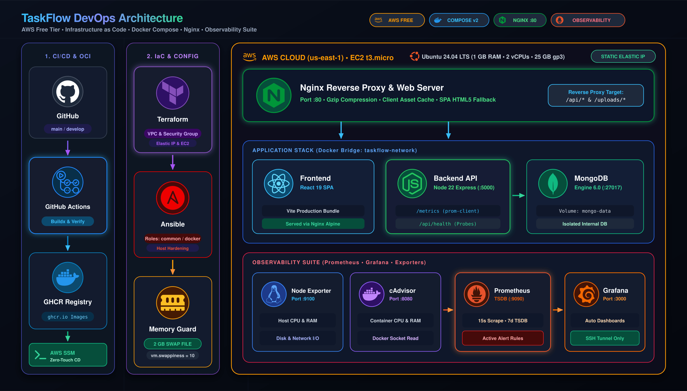

# TaskFlow — AWS Free Tier DevOps & Deployment Guide (Docker, Terraform & CI/CD)

This project includes a streamlined, production-grade Infrastructure-as-Code (Terraform), Containerization (Docker & Docker Compose), and automated CI/CD pipeline (GitHub Actions) engineered specifically to operate **100% within the AWS Free Tier**.

---

## Architecture Overview

<p align="center">
  
</p>

---

## Directory Structure

```
taskflow/
├── docker-compose.prod.yml       # Production multi-container orchestration
├── docker-compose.dev.yml        # Local development orchestration
├── terraform/                    # Infrastructure as Code
│   ├── main.tf                  # VPC, Subnet, Security Group, EC2 + Cloud-Init Docker, Elastic IP
│   ├── variables.tf             # Input variables (region, instance type, keys)
│   ├── outputs.tf               # Public IP, SSH command, application URL
│   ├── terraform.tfvars.example # Example variable values
│   └── terraform.tfvars         # Your local configuration (gitignored)
├── .github/workflows/
│   └── ci-cd.yml                # CI test, GHCR build/push, and EC2 Docker Compose deployment
├── server/
│   ├── Dockerfile.prod          # Multi-stage Node.js backend container
│   └── ...
└── client/
    ├── Dockerfile.prod          # Multi-stage React + Nginx static server container
    └── ...
```

---

## Step 1: Provision Infrastructure with Terraform

1. Move to the `terraform/` directory:
   ```bash
   cd terraform
   ```

2. Configure your variables in `terraform.tfvars`:
   ```hcl
   aws_region       = "us-east-1"
   key_pair_name    = "my-aws-key"
   private_key_file = "~/.ssh/my-aws-key.pem"
   instance_type    = "t3.micro"  # Free Tier eligible in us-east-1
   ```

3. Initialize and apply:
   ```bash
   terraform init
   terraform apply -auto-approve
   ```

### What Terraform does automatically:
- Provisions the VPC, Subnet, and Security Group (ports 22, 80, 443).
- Launches an **EC2 `t3.micro`** instance.
- Automatically executes a **cloud-init script**:
  - Configures **2 GB of Swap space** (keeps the 1 GB RAM instance stable).
  - Installs **Docker** and **Docker Compose plugin**.
  - Adds the `ubuntu` user to the `docker` group.
  - Prepares `/home/ubuntu/taskflow-app`.
- Attaches an **Elastic IP** and outputs your connection command and application URL.

---

## Step 2: Configure GitHub Repository Secrets

In your GitHub repository, navigate to **Settings** → **Secrets and variables** → **Actions** → **New repository secret**:

| Secret Name | Value | Description |
| :--- | :--- | :--- |
| `EC2_HOST` | Output from `terraform output ec2_public_ip` (e.g. `3.211.185.56`) | Elastic IP of the EC2 instance |
| `EC2_USER` | `ubuntu` | Default SSH user |
| `SSH_PRIVATE_KEY` | Entire content of `~/.ssh/my-aws-key.pem` | SSH private key for authentication |
| `MONGODB_URI` *(Optional)* | Your MongoDB Atlas connection URI | Cloud MongoDB (or uses container MongoDB) |
| `JWT_SECRET` *(Optional)* | Random 32+ character string | Token encryption key |

---

## Step 3: Deploy via CI/CD

Push your code to trigger the automated deployment:

```bash
git push origin develop
# (or git push origin main)
```

GitHub Actions will automatically:
1. Verify backend dependencies and compile the React frontend bundle.
2. Build multi-stage production Docker images and push them to **GitHub Container Registry (`ghcr.io`)**.
3. Connect to your EC2 instance via SSH.
4. Pull the latest images and start your containers with `docker compose up -d`.
5. Access your live application at **`http://<EC2_PUBLIC_IP>`**.

---

## Step 4: Tear Down (Clean up AWS Resources)

To terminate the EC2 instance, release the Elastic IP, and delete all AWS resources:

```bash
cd terraform
terraform destroy -auto-approve
```
