# TaskFlow - DevOps & Cloud Infrastructure Guide

[](https://github.com/thilinagamage001/taskflow-app/actions/workflows/ci-cd.yml)
[](https://www.docker.com/)
[](https://docs.docker.com/compose/)
[](https://nginx.org/)
[](https://www.terraform.io/)
[](https://www.ansible.com/)
[](https://prometheus.io/)
[](https://grafana.com/)
[](https://aws.amazon.com/free/)
[](LICENSE)

An enterprise-grade, cost-optimized DevOps implementation for **TaskFlow** (a full-stack MERN task management application). Engineered to run **100% within the AWS Free Tier ($0/month)** on an EC2 `t3.micro` instance, this project showcases modern cloud infrastructure, declarative Infrastructure as Code (IaC), zero-touch CI/CD automation with AWS Systems Manager (SSM), production reverse-proxying with Nginx, and full-stack observability with Prometheus, Grafana, Node Exporter, and cAdvisor.

---

## Table of Contents

- [DevOps Architecture](#devops-architecture)
- [Key DevOps Capabilities](#key-devops-capabilities)
- [DevOps Tech Stack Matrix](#devops-tech-stack-matrix)
- [Repository Layout](#repository-layout)
- [Local Development with Docker](#local-development-with-docker)
- [Infrastructure as Code (Terraform)](#infrastructure-as-code-terraform)
- [Configuration Management (Ansible)](#configuration-management-ansible)
- [Continuous Integration & Zero-Touch Deployment (CI/CD)](#continuous-integration--zero-touch-deployment-cicd)
- [Full-Stack Observability & Monitoring](#full-stack-observability--monitoring)
- [Security, Reliability & AWS Cost Optimization](#security-reliability--aws-cost-optimization)
- [Operational Runbook & Troubleshooting](#operational-runbook--troubleshooting)
- [License](#license)

---

## DevOps Architecture

<p align="center">
  
</p>


## Key DevOps Capabilities

1. **Zero-Touch Automated CI/CD (AWS Systems Manager)**:
   - Deployments execute over the AWS Systems Manager (SSM) agent using instance IAM profiles.
   - Eliminates the need to open port 22 to the public internet or store sensitive SSH private keys in GitHub repository secrets for production rollouts.
   - Supports automated fallback to SSH/SCP if AWS SSM credentials are not configured.

2. **High-Performance Production Reverse Proxy (Nginx Alpine)**:
   - Frontend multi-stage build uses `node:22-alpine` for asset compilation and `nginx:alpine` for serving static assets.
   - Built-in Gzip compression, HTTP security headers (`nosniff`, `SAMEORIGIN`, `strict-origin-when-cross-origin`), client-side cache control, and reverse proxy routing for `/api/` and `/uploads/` directly to the backend.

3. **Complete Observability & Proactive Alerting**:
   - Prometheus metrics engine pre-configured to scrape the Express API (`prom-client`), container metrics (`cAdvisor`), host system metrics (`Node Exporter`), and internal state.
   - Prometheus alerting rules covering High CPU utilization (>85%), High Memory utilization (>85%), API downtime (`up == 0`), and elevated HTTP 5xx error rates (>5%).
   - Auto-provisioned Grafana datasource for instant dashboard exploration without manual configuration.

4. **100% Free Tier Optimization & Memory Safeguards**:
   - Runs comfortably on a single `t3.micro` instance (1 GB RAM, 2 vCPUs, 25 GB gp3 storage).
   - Automated cloud-init provisioning sets up a **2 GB Swap file** with `vm.swappiness=10`, shielding the node from Out-Of-Memory (OOM) kernel kills during Docker image pulls and multi-container execution.

5. **Dual Infrastructure Automation (Terraform + Ansible)**:
   - **Terraform**: Manages AWS cloud fabric (VPC, Subnet, Route Tables, Internet Gateway, Security Groups, IAM Roles & SSM Instance Profiles, EC2, and Elastic IP).
   - **Ansible**: Modular playbooks and roles (`common`, `docker`, `taskflow`) providing an alternative, idempotent host configuration and application deployment workflow.

---

## DevOps Tech Stack Matrix

| Category | Technology | Purpose & Implementation |
| :--- | :--- | :--- |
| **Cloud Provider** | AWS (Free Tier) | Elastic Compute Cloud (EC2 `t3.micro`), Elastic IP, IAM, Systems Manager. |
| **IaC** | Terraform `>= 1.5.0` | Declarative cloud resource provisioning with AWS provider `~> 5.0`. |
| **Config Management**| Ansible | Modular roles (`common`, `docker`, `taskflow`) for OS hardening and container deployment. |
| **Container Engine** | Docker & Buildx | Multi-stage production container images reducing image footprints by over 70%. |
| **Orchestration** | Docker Compose v2 | Isolated network bridge (`taskflow-network`), health checks, named persistent volumes. |
| **Web Server / Proxy**| Nginx (Alpine) | SPA routing fallback, static asset caching, Gzip compression, and reverse proxy. |
| **CI/CD Platform** | GitHub Actions | Automated linting, test validation, GHCR container publishing, and zero-touch deployment. |
| **Container Registry**| GHCR (`ghcr.io`) | Secure OCI-compliant container image registry hosted on GitHub. |
| **Host Metrics** | Prometheus Node Exporter | Linux kernel and system hardware metrics collection (`:9100`). |
| **Container Metrics** | Google cAdvisor | Live Docker container CPU, memory, filesystem, and network statistics (`:8080`). |
| **App Instrumentation**| `prom-client` | Express middleware collecting request counters, latency histograms, and Node.js runtime metrics. |
| **Metrics Database** | Prometheus | Time-series metrics engine with scrape loops and rule-based alerting (`:9090`). |
| **Dashboards** | Grafana | Observability visualization platform with automated datasource provisioning (`:3000`). |

---

## Repository Layout

```
taskflow-app/
├── .github/workflows/
│   └── ci-cd.yml                     # 3-Stage Pipeline: Lint/Test -> Build & GHCR Push -> SSM/SSH Deploy
├── ansible/                          # Ansible Automation Suite
│   ├── ansible.cfg                   # Ansible runtime configuration
│   ├── inventory/
│   │   ├── generate-inventory.sh     # Dynamically fetches EC2 IP from Terraform output
│   │   └── production.ini            # Production host inventory
│   ├── playbooks/
│   │   ├── provision.yml             # Host configuration playbook (common + docker)
│   │   └── deploy.yml                # Application deployment playbook (taskflow role)
│   └── roles/
│       ├── common/                   # Base OS hardening & 2GB swap setup
│       ├── docker/                   # Docker Engine & Compose v2 installation
│       └── taskflow/                 # Application environment, compose pull, and health validation
├── client/                           # React 19 Frontend SPA
│   ├── Dockerfile.dev                # Development container (Vite dev server)
│   ├── Dockerfile.prod               # Multi-stage production container (Node 22 build -> Nginx Alpine)
│   ├── nginx/
│   │   ├── default.conf              # Static Nginx reverse proxy configuration
│   │   └── default.conf.template     # Template for dynamic environment variable substitution
│   └── src/                          # Application source code
├── server/                           # Express.js REST API Backend
│   ├── Dockerfile.dev                # Development container with nodemon hot-reload
│   ├── Dockerfile.prod               # Multi-stage production container (pruned dependencies)
│   └── src/
│       ├── config/metrics.js         # Prometheus prom-client registry & metrics definition
│       ├── middleware/metrics.js      # HTTP request latency & response code recording middleware
│       └── app.js                    # Express application entry point (includes /metrics & /api/health)
├── monitoring/                       # Observability & Monitoring Infrastructure
│   ├── prometheus/
│   │   ├── prometheus.yml            # Prometheus scrape targets (API, Node Exporter, cAdvisor)
│   │   └── rules/alerts.yml          # Production alerting rules (CPU, Memory, API down, 5xx rate)
│   └── grafana/
│       └── provisioning/datasources/
│           └── prometheus.yml        # Auto-provisioned Prometheus datasource configuration
├── terraform/                        # Infrastructure as Code (AWS Free Tier)
│   ├── main.tf                       # VPC, Subnet, SG, IAM SSM Role, EC2 (t3.micro), Elastic IP, Cloud-Init
│   ├── variables.tf                  # Parameterized configuration variables
│   ├── outputs.tf                    # Public IP, instance ID, SSH string, application URL
│   ├── terraform.tfvars.example      # Example input variables
│   └── terraform.tfvars              # User-specific variable overrides (gitignored)
├── docker-compose.dev.yml            # Full local development stack (App + DB + Monitoring)
├── docker-compose.prod.yml           # Production multi-container orchestration stack
├── DEPLOYMENT.md                     # Detailed AWS deployment runbook
└── LICENSE                           # MIT License
```

---

## Local Development with Docker

Spin up the entire stack locally (Frontend, Backend API, MongoDB, Prometheus, Node Exporter, cAdvisor, and Grafana) with a single command:

```bash
# Clone the repository
git clone https://github.com/thilinagamage001/taskflow-app.git
cd taskflow-app

# Launch local development environment
docker compose -f docker-compose.dev.yml up --build
```

### Local Service Endpoints

| Service | Endpoint | Description |
| :--- | :--- | :--- |
| **Frontend UI** | `http://localhost:5173` | React application with Vite hot-module replacement |
| **Backend API** | `http://localhost:5000` | Express REST API server |
| **API Health Check** | `http://localhost:5000/api/health` | Health probe returning application status |
| **Prometheus Metrics**| `http://localhost:5000/metrics` | Raw Prometheus exposition endpoint |
| **Prometheus UI** | `http://localhost:9090` | Time-series query interface and alert status |
| **Grafana Dashboard** | `http://localhost:3000` | Metrics visualizer (Default: `admin` / `admin`) |
| **cAdvisor Metrics** | `http://localhost:8080` | Container resource monitoring UI |
| **Node Exporter** | `http://localhost:9100` | Host hardware metrics endpoint |

---

## Infrastructure as Code (Terraform)

The `terraform/` directory manages all AWS cloud resources declaratively, adhering strictly to the **AWS Free Tier**.

### Resources Provisioned
- **VPC & Subnet**: Dedicated CIDR `10.0.0.0/16` with a public subnet (`10.0.1.0/24`) and Internet Gateway.
- **Security Group**: Ingress for Port 80 (HTTP), Port 443 (HTTPS), and Port 22 (SSH).
- **IAM Role & Instance Profile**: Attaches `AmazonSSMManagedInstanceCore` to enable agent-based zero-touch deployment via AWS Systems Manager without inbound SSH port exposure.
- **EC2 Instance**: `t3.micro` running Ubuntu 24.04 LTS with 25 GB encrypted `gp3` root volume.
- **Cloud-Init Automation (`user_data`)**:
  - Automatically allocates and enables a **2 GB Swap file** (`/swapfile`) with `vm.swappiness=10`.
  - Installs Docker Engine, Docker Compose v2 plugin, and enables the systemd Docker daemon.
  - Adds the `ubuntu` user to the `docker` group.
  - Ensures the Amazon SSM Agent service is active.
- **Elastic IP (EIP)**: Allocates and associates a static public IPv4 address.

### Provisioning Steps

```bash
cd terraform

# 1. Initialize Terraform working directory
terraform init

# 2. Review execution plan
terraform plan

# 3. Apply infrastructure
terraform apply -auto-approve

# 4. Inspect infrastructure outputs
terraform output
```

---

## Configuration Management (Ansible)

For scenarios requiring direct configuration management or manual server bootstrapping, modular Ansible playbooks are provided.

### 1. Generate Inventory from Terraform Output
```bash
./ansible/inventory/generate-inventory.sh
```

### 2. Provision Host Environment
Executes the `common` (OS configuration, 2GB swap, security hardening) and `docker` (official Docker CE repo and Compose v2) roles:
```bash
ansible-playbook -i ansible/inventory/production.ini ansible/playbooks/provision.yml
```

### 3. Deploy Application Stack
Deploys the production Docker Compose stack, templates environment variables, authenticates with GHCR, pulls new images, and tests the health endpoint:
```bash
IMAGE_TAG=latest ansible-playbook -i ansible/inventory/production.ini ansible/playbooks/deploy.yml
```

---

## Continuous Integration & Zero-Touch Deployment (CI/CD)

<p align="center">
  
</p>

The CI/CD pipeline defined in [`.github/workflows/ci-cd.yml`](.github/workflows/ci-cd.yml) automates testing, container image packaging, and deployment to AWS.

```mermaid
sequenceDiagram
    autonumber
    actor Dev as Developer
    participant GH as GitHub Repository
    participant Runner as GitHub Actions Runner
    participant GHCR as GitHub Container Registry
    participant SSM as AWS Systems Manager
    participant EC2 as AWS EC2 (t3.micro)

    Dev->>GH: git push (main / develop)
    GH->>Runner: Trigger CI/CD Workflow
    
    rect rgb(30, 40, 60)
        Note over Runner: Stage 1: Lint & Build Verification
        Runner->>Runner: Setup Node.js 22 & Restore Cache
        Runner->>Runner: npm ci (server & client)
        Runner->>Runner: npm run lint & npm run build
    end

    rect rgb(40, 50, 70)
        Note over Runner: Stage 2: Docker Buildx & GHCR Push
        Runner->>Runner: Generate Short SHA Tag
        Runner->>GHCR: Authenticate via GITHUB_TOKEN
        Runner->>GHCR: Build & Push taskflow-server (:latest, :sha)
        Runner->>GHCR: Build & Push taskflow-client (:latest, :sha)
    end

    rect rgb(50, 60, 80)
        Note over Runner, EC2: Stage 3: Zero-Touch Deployment
        Runner->>SSM: aws ec2 describe-instances (tag:Project=taskflow)
        Runner->>SSM: aws ssm send-command (RunShellScript payload)
        SSM->>EC2: Execute deployment payload as root
        EC2->>EC2: Pull updated repo config & template .env
        EC2->>GHCR: docker login & docker compose pull
        EC2->>EC2: docker compose up -d --remove-orphans
        EC2->>EC2: Validate http://localhost/api/health (retry loop)
        EC2-->>SSM: Command status & logs (Success)
        SSM-->>Runner: Command Completed
    end
```



### Required GitHub Secrets

Configure these secrets in **GitHub Repo** → **Settings** → **Secrets and variables** → **Actions**:

| Secret Name | Required For | Description |
| :--- | :--- | :--- |
| `AWS_ACCESS_KEY_ID` | **Method A (Zero-Touch SSM)** | IAM user key with `ssm:SendCommand` and `ec2:DescribeInstances` |
| `AWS_SECRET_ACCESS_KEY` | **Method A (Zero-Touch SSM)** | IAM secret key corresponding to the Access Key ID |
| `AWS_REGION` | **Method A (Zero-Touch SSM)** | AWS region where resources are provisioned (default: `us-east-1`) |
| `EC2_HOST` | **Method B (SSH Fallback)** | Public Elastic IP address of the EC2 instance |
| `SSH_PRIVATE_KEY` | **Method B (SSH Fallback)** | Private key (`.pem`) content matching the AWS key pair |
| `MONGODB_URI` | Both | MongoDB connection string (or defaults to internal container DB) |
| `JWT_SECRET` | Both | Secret key for JWT signing and token authentication |
| `GRAFANA_ADMIN_PASSWORD` | Both | Administrator password for Grafana UI access |

---

## Full-Stack Observability & Monitoring

<p align="center">
  
</p>

The production stack incorporates a complete 3-pillar observability pipeline designed to give end-to-end visibility into infrastructure health, container performance, and application behavior:
- **Metrics Collection**: Host telemetry via Node Exporter, container resource usage via Google cAdvisor, and Express application instrumentation via `prom-client` at `/metrics`.
- **Time-Series Storage & Rules**: Centralized Prometheus engine evaluating 4 proactive alert rules every 15 seconds with 7-day TSDB data retention.
- **Visual Analytics**: Auto-provisioned Grafana dashboards securely isolated on loopback (`127.0.0.1:3000`) for encrypted SRE SSH tunnel access.

### Pre-configured Alert Rules ([`monitoring/prometheus/rules/alerts.yml`](monitoring/prometheus/rules/alerts.yml))

1. **`HighCPUUsage`**: Triggers a `warning` when EC2 host CPU utilization exceeds 85% for more than 5 minutes.
2. **`HighMemoryUsage`**: Triggers a `critical` alert when available system memory drops below 15% for more than 5 minutes.
3. **`APIUnavailable`**: Triggers a `critical` alert when the TaskFlow backend metrics target is unreachable (`up == 0`) for 1 minute.
4. **`HighAPIErrorRate`**: Triggers a `warning` when HTTP 5xx responses exceed 5% of total request traffic over a 5-minute sliding window.

### Accessing Grafana in Production

For security, Grafana is bound to `127.0.0.1:3000` on the EC2 host. Access it securely via an SSH tunnel:

```bash
# Create local port-forwarding tunnel
ssh -i ~/.ssh/my-aws-key.pem -L 3000:localhost:3000 ubuntu@<EC2_PUBLIC_IP>

# Open in your local browser
# URL: http://localhost:3000
# User: admin
# Password: <GRAFANA_ADMIN_PASSWORD>
```

---

## Security, Reliability & AWS Cost Optimization

### Security Posture
- **Least-Privilege Deployments**: AWS Systems Manager relies on short-lived IAM credentials and role-based access, removing the necessity of exposing port 22 to `0.0.0.0/0`.
- **Hardened Nginx Configuration**: Includes security headers (`X-Content-Type-Options: nosniff`, `X-Frame-Options: SAMEORIGIN`, `Referrer-Policy: strict-origin-when-cross-origin`) and limits upload payload sizes (`client_max_body_size 10M`).
- **Network Isolation**: Backend API, database, and monitoring components communicate across an internal Docker bridge network (`taskflow-network`); only Nginx exposes public port 80.
- **Root Volume Encryption**: The EC2 EBS volume is encrypted at rest using AWS KMS default keys.

### Memory & System Reliability
- **2 GB Swap Safeguard**: Prevents Linux kernel OOM-killer invocations on the 1 GB `t3.micro` instance during concurrent operations.
- **Docker Image Pruning**: Automated post-deployment cleanup (`docker image prune -f`) ensures the 25 GB EBS disk never fills with dangling images.
- **Container Restarts**: All services configure `restart: unless-stopped` for automatic self-healing upon container failure or instance reboot.

### AWS Free Tier Compliance ($0.00 / month)
- **Compute**: 1 × `t3.micro` (750 hours/month free under AWS 12-Month Free Tier).
- **Storage**: 25 GB gp3 EBS (30 GB/month free tier allowance).
- **Static IPv4**: 1 × Elastic IP attached to a running instance (no charges apply when associated with an active EC2 instance).
- **Deployments**: AWS Systems Manager Core features are included at no additional cost.

---

## Operational Runbook & Troubleshooting

### Essential Host Commands

```bash
# SSH into the EC2 Host
ssh -i ~/.ssh/my-aws-key.pem ubuntu@<EC2_PUBLIC_IP>

# Check status of running containers
docker compose -f /home/ubuntu/taskflow-app/docker-compose.prod.yml ps

# View live application logs
docker compose -f /home/ubuntu/taskflow-app/docker-compose.prod.yml logs -f --tail=100 api
docker compose -f /home/ubuntu/taskflow-app/docker-compose.prod.yml logs -f --tail=100 frontend

# Inspect system resource usage (RAM, Swap, CPU)
free -h
top
docker stats --no-stream
```

### Health Check Verification
```bash
# Test API health from the host
curl -i http://localhost/api/health

# Test metrics endpoint
curl -s http://localhost:5000/metrics | grep http_request_total
```

### Manual Restart / Rollout
```bash
cd /home/ubuntu/taskflow-app
docker compose -f docker-compose.prod.yml pull
docker compose -f docker-compose.prod.yml up -d --remove-orphans
```

### Complete Teardown (Clean up Cloud Infrastructure)
To terminate all AWS resources and prevent any unexpected charges:

```bash
cd terraform
terraform destroy -auto-approve
```

---

## License

This project is licensed under the MIT License see the [LICENSE](LICENSE) file for details.
